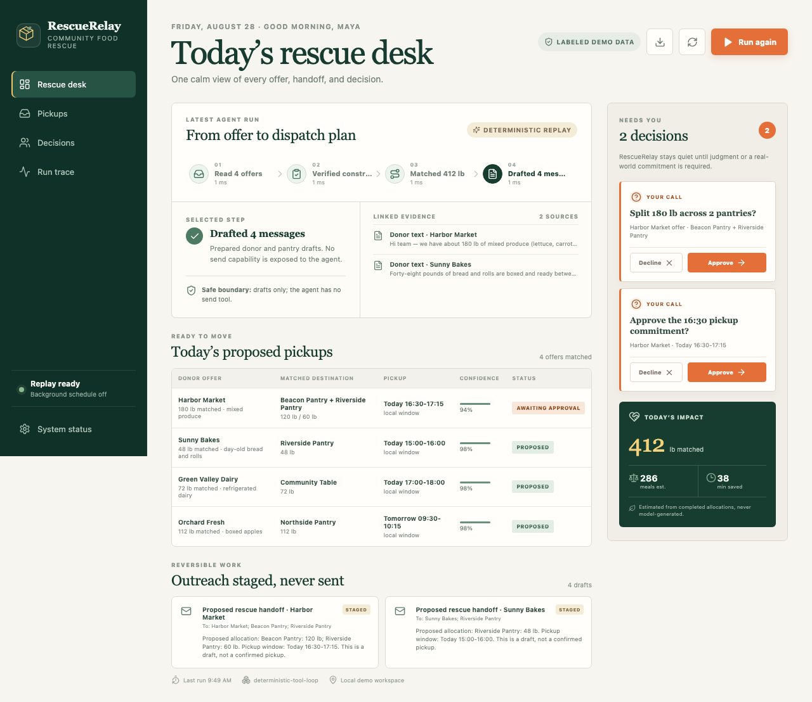
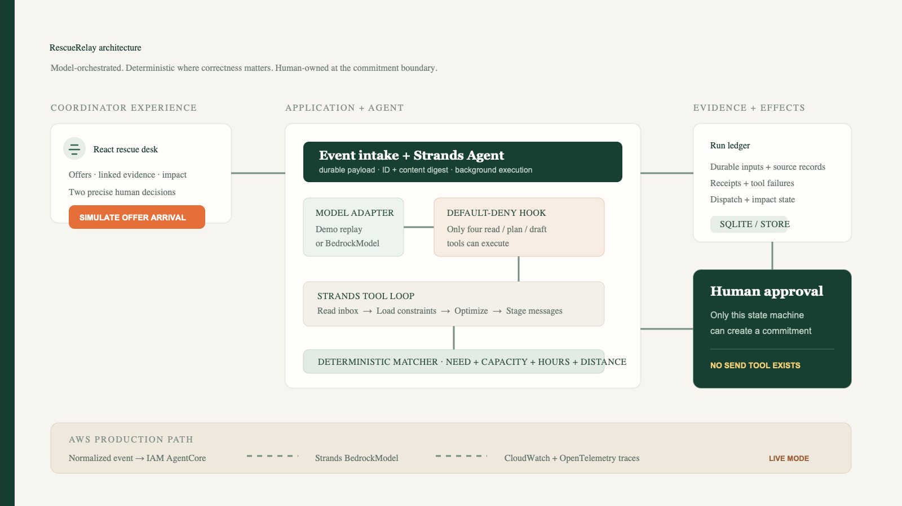
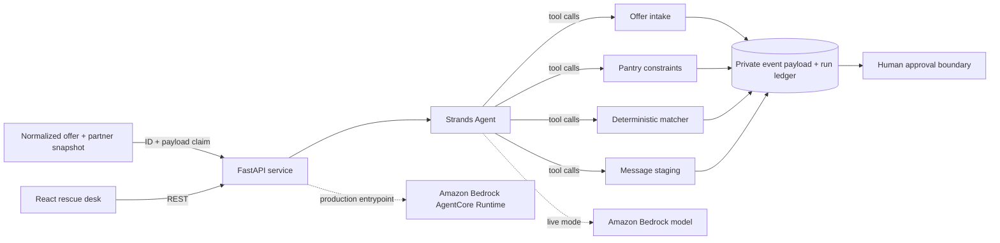

# RescueRelay

[](https://github.com/tarang-tj/rescue-relay/actions/workflows/ci.yml)
[](LICENSE)
[](https://www.python.org/)

**A Strands-powered dispatch agent that turns messy surplus-food offers into safe, evidence-backed pantry pickups.**

Food-bank coordinators spend critical hours reading donor messages, checking pantry constraints, splitting loads, and chasing approvals while fresh food loses shelf life. RescueRelay handles that coordination loop end to end. It reads offers, applies deterministic capacity and timing rules, proposes a dispatch plan, and stages the outreach. A human is interrupted only when a real commitment or ambiguous split needs approval.

An offer-arrival event starts that work in the background. RescueRelay validates and durably persists the event's normalized offers and partner snapshot before execution. Every event is claimed by both ID and payload digest, so exact retries are safe while an ID reused with different content is rejected. Failures remain visible instead of being acknowledged as success; live HTTP events also fail closed unless an event token is configured.

Built for the **Good Neighbor Agents** track of AWS's Agents for Humans Hackathon.



## Why this is an agent—not a chatbot

RescueRelay runs a real Strands Agents SDK tool loop. The model can invoke four narrow tools in order:

1. Read new donor offers and preserve their source evidence.
2. Load pantry needs, hours, cold-storage capacity, and route constraints.
3. Run a deterministic matcher that produces auditable allocations.
4. Stage—not send—dispatch messages and create approval decisions.

The model cannot send messages or silently commit a pickup. A structural `BeforeToolCallEvent` guard defaults to denial for unknown tools, and the database only changes a dispatch to `scheduled` after its related decisions are approved.

## Product tour

- **Rescue desk:** one calm operating view for offers, allocations, decisions, and impact.
- **Evidence trail:** every run step records what happened and which source data justified it.
- **Decision rail:** approve or decline precise tradeoffs; a rejection safely cancels the related dispatch.
- **Outreach drafts:** complete recipient, subject, and body records are persisted but structurally cannot be sent.
- **Portable audit:** download a machine-readable evidence bundle for the run, safeguards, and decisions.
- **Impact ledger:** pounds rescued, estimated meals, and coordinator time saved are derived from completed allocations.
- **Fail-loud execution:** errors become visible failed runs; they never masquerade as successful autonomy.
- **Quiet event intake:** durable receipts and normalized inputs survive restarts; exact retries are no-ops, conflicting retries fail closed, and one runtime serializes bursts instead of overlapping agent runs.

## Architecture





The local demo uses a clearly labeled scripted Strands `Model` adapter so judges can replay the complete tool loop without AWS credentials. Live mode swaps only that adapter for `BedrockModel`; the same tools, guardrails, store, and UI remain in use.

## Quick start

Prerequisites: Python 3.11–3.13, [uv](https://docs.astral.sh/uv/), and Node.js 20+.

```bash
uv sync --extra dev
uv run uvicorn rescue_relay.api:app --reload --port 8000
```

In a second terminal:

```bash
cd frontend
npm install
npm run dev
```

Open `http://localhost:5173`, then select **Simulate offer arrival**. The event-driven replay is explicitly labeled and contains four local donor offers totaling 412 lb.

To prove that intake is not hard-wired to those fixtures, post the checked-in normalized sample while the API is running:

```bash
curl --fail-with-body -X POST http://localhost:8000/api/events/offers \
  -H 'Content-Type: application/json' \
  --data @examples/offer-event.json
```

That event drives the same Strands tools with its own 36 lb offer and partner snapshot. The event response exposes only a receipt and SHA-256 payload fingerprint rather than echoing the raw payload; source evidence remains visible to the coordinator in the dashboard. A live request uses the same schema, requires `mode: "live"`, a configured `RESCUERELAY_EVENT_TOKEN`, and a bearer token.

### Container

The multi-stage image builds the frontend and serves it from the FastAPI process:

```bash
docker build -t rescue-relay .
docker run --rm -p 8000:8000 rescue-relay
```

Open `http://localhost:8000`.

### CLI

```bash
uv run rescue-relay reset
uv run rescue-relay scan --mode demo
uv run rescue-relay dashboard
```

### Live Bedrock mode

Configure normal AWS credentials and region, then optionally choose a model:

```bash
export AWS_REGION=us-east-1
export RESCUERELAY_MODEL_ID=us.amazon.nova-pro-v1:0
uv run rescue-relay scan --mode live
```

No credentials are stored by the project. Live execution requires access to the selected Amazon Bedrock model.

## AgentCore entrypoint

`src/rescue_relay/agentcore_app.py` exposes the agent through `BedrockAgentCoreApp`. Its direct Runtime payload accepts:

```json
{"action": "event", "event_id": "judge-demo-0001", "source": "demo_inbox", "mode": "demo"}
```

Live events include validated `offers` and `partners` arrays in the same shape as `examples/offer-event.json`. The `event` action is content-safe idempotent: replaying the same source ID and payload returns its durable receipt without rerunning the agent, while changing content under that ID returns a conflict. The runtime also supports `scan`, `dashboard`, `approve`, and `resolve`. The current AgentCore CLI's text-wrapped JSON invocation format is accepted and tested as well. The runtime uses `/tmp/rescue-relay-agentcore.db`, keeping writes within AgentCore's writable runtime path. Run `./scripts/prepare-agentcore.sh` to generate a pinned, AWS-IAM-protected deployment project, and see `docs/agentcore.md` for the verified deployment workflow.

## Verification

Run every locally reproducible gate with one command:

```bash
./scripts/verify.sh
```

On a Docker-enabled machine, include the container build:

```bash
./scripts/verify.sh --with-docker
```

The underlying commands are:

```bash
uv run ruff check .
uv run pytest --cov=rescue_relay --cov-report=term-missing --cov-fail-under=95
uv run python evals/run_evals.py
cd frontend && npm run lint && npm run build && npm run test:e2e
docker build -t rescue-relay .
```

The suite covers matching invariants, capacity and date grounding, partial allocation, approval and rejection transitions, persisted drafts, audit export, run history, custom event inputs, restart persistence, bounded-receipt deduplication, conflicting retries, authenticated live intake, the real Strands tool loop, REST behavior, fail-closed tool authorization, and desktop/mobile browser flows.

## Repository map

```text
src/rescue_relay/   Strands agent, tools, matcher, store, API, AgentCore app
frontend/           React/Vite product interface
tests/              unit, integration, and agent-loop tests
docs/               architecture, deployment, pitch, and demo materials
evals/              reproducible evaluation cases and runner
examples/           executable normalized event payload
```

See the [requirements and judging matrix](docs/requirements-matrix.md) for direct evidence links and the [pilot plan](docs/pilot-plan.md) for how the impact hypothesis would be validated with a real food-rescue network.
The dated [verification record](docs/verification.md) distinguishes locally proven gates from the Docker and authenticated-deployment checks that still need an external runner.

## Safety and data boundaries

- Donor text is untrusted data, never executable instruction.
- Matching math is deterministic and tested independently from model behavior.
- Outbound communication is staged; no send capability exists.
- Commitments require persisted human approval.
- Demo data and replay mode are visibly labeled; neither is presented as live production evidence.
- The local demo uses a simulated inbox event and durable background receipt; the checked-in custom event proves the payload adapter but is not presented as a connected production inbox.
- Live HTTP event intake requires `RESCUERELAY_EVENT_TOKEN`; the AgentCore deployment path uses AWS IAM authorization.

## License

[MIT](LICENSE). The license is committed at the repository root so GitHub can surface it in the repository **About** panel.
