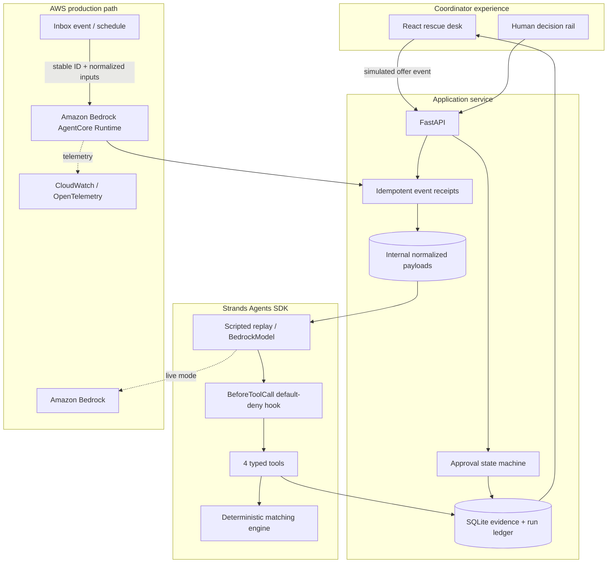

# RescueRelay architecture

## Trust boundaries

1. Donor messages enter as untrusted data and are persisted as evidence.
2. Strands orchestrates the workflow, but deterministic code owns allocation math.
3. The hook layer rejects tools outside read, constrain, optimize, and stage.
4. The agent has no outbound send tool.
5. The decision state machine is the only path from `awaiting_approval` to `scheduled`; rejection moves the dispatch to `declined` and rejects sibling decisions atomically.
6. Message drafts and audit bundles are durable records, but neither creates an external side effect.
7. An offer event's validated offers and partner snapshot are atomically persisted with its receipt before execution. An exact duplicate returns the original receipt and cannot rerun the agent; reusing the ID for different content is rejected by payload digest.
8. Live HTTP events require a configured bearer token; the AgentCore runtime is configured for AWS IAM authorization.
9. Accepted events are serialized within one runtime, preventing overlapping mutations; a multi-instance deployment still requires the shared-store concurrency control described below.

## Runtime modes

| Mode | Model adapter | Purpose | Claim boundary |
|---|---|---|---|
| `demo` | `ScriptedToolModel` implementing Strands `Model` | Repeatable judge demo or custom-payload adapter test | Labeled fixture or caller-supplied normalized inputs; no AWS model claim |
| `live` | Strands `BedrockModel` | Production reasoning | Requires validated offers and partner snapshot, AWS credentials, and model access |

Both modes execute the same Strands `Agent`, tools, hook, matcher, persistence layer, and frontend.

The local product demonstrates asynchronous ingestion with a labeled simulated inbox event. FastAPI validates and durably persists normalized inputs and a receipt, returns `202 Accepted`, and executes the Strands run as a background task; the UI polls the receipt and surfaces the result only when complete or failed. The executable payload in `examples/offer-event.json` proves the tools consume caller-supplied data rather than only fixtures. AgentCore exposes the same content-safe idempotent `event` action for an AWS event source. Connecting an authenticated source transformer and replacing runtime-local SQLite with a shared store remain production integration work and are not claimed by the demo.
